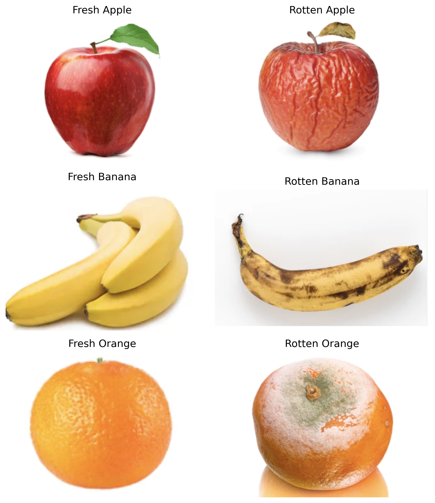
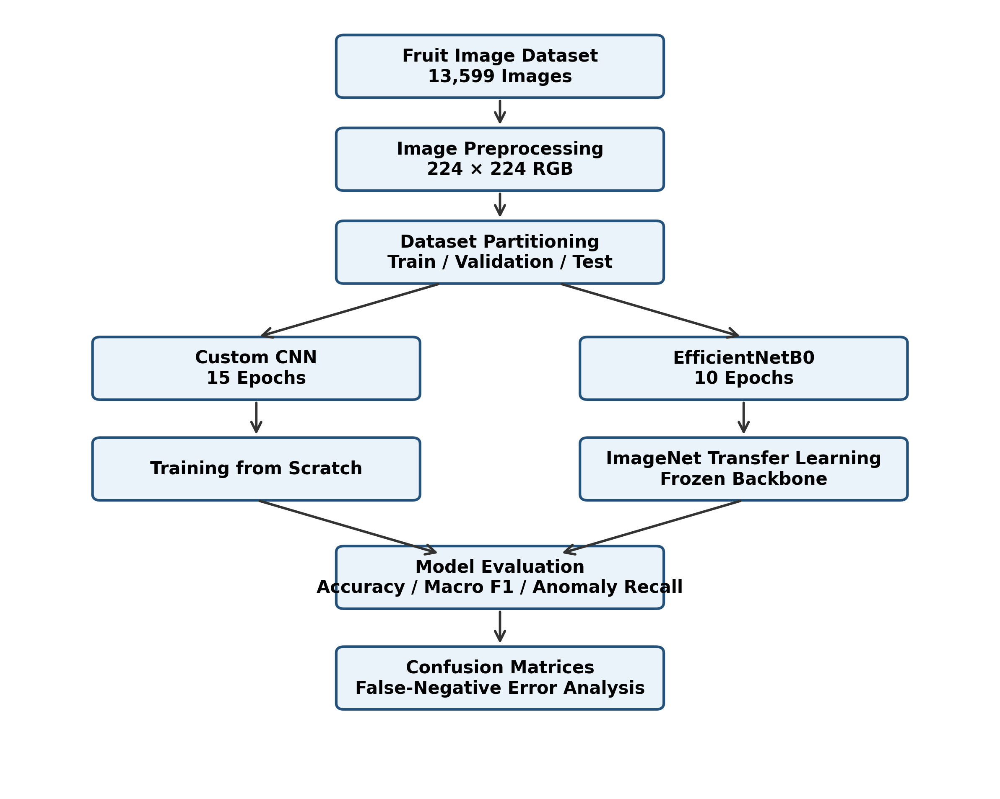
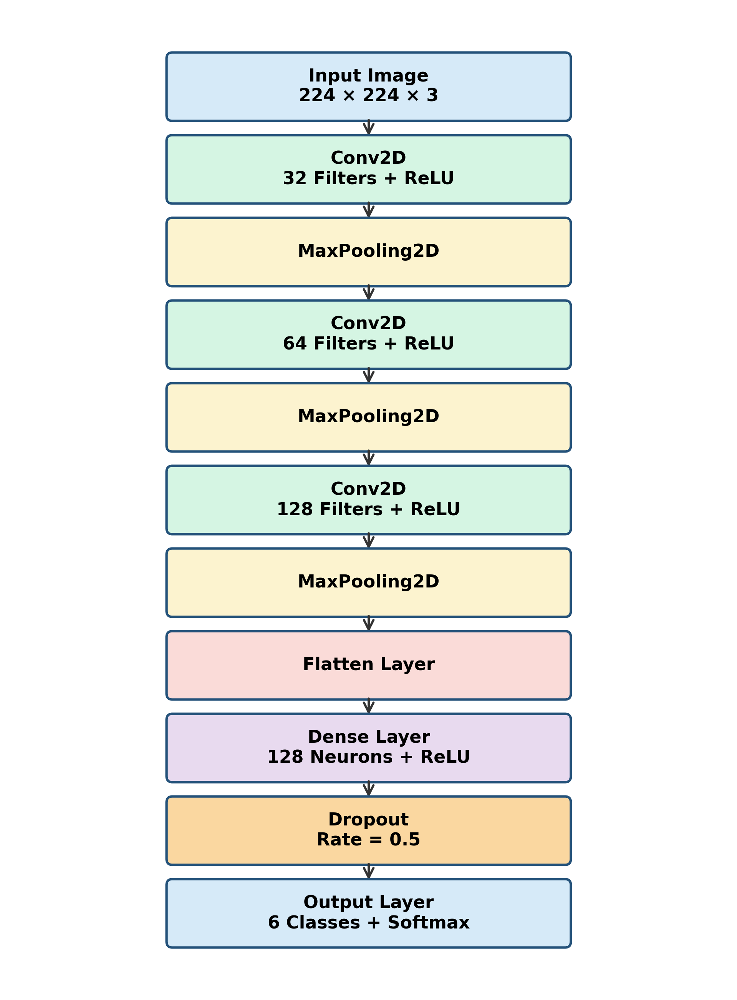
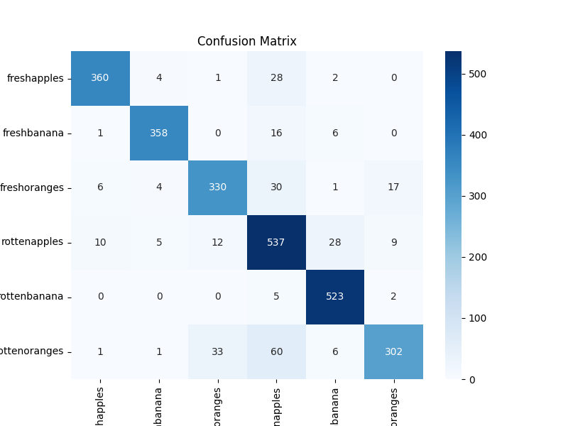
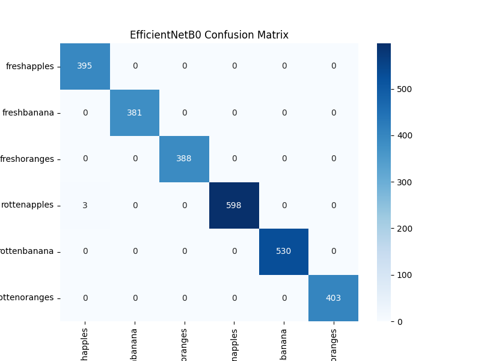

# Visible Food Surface Anomaly Classification

**Deep learning for six-class classification of fresh and rotten fruit images using a Custom CNN and EfficientNetB0.**

This project investigates whether image classification models can identify *visible* signs associated with fruit deterioration. It compares a convolutional neural network (CNN) trained from scratch with an ImageNet-pretrained EfficientNetB0 transfer-learning model. The experiments cover apples, bananas, and oranges, each labelled fresh or rotten.

> **Scope:** This is a visual screening research project, **not** a food-safety certification tool. Image appearance alone cannot establish microbial contamination or whether food is safe to eat.

## Dataset

**Source:** [Fruits Fresh and Rotten for Classification — Kaggle](https://www.kaggle.com/datasets/sriramr/fruits-fresh-and-rotten-for-classification)

The dataset contains six classes:

- `freshapples`
- `freshbanana`
- `freshoranges`
- `rottenapples`
- `rottenbanana`
- `rottenoranges`

| Partition | Images |
|---|---:|
| Training | 8,721 |
| Validation | 2,180 |
| Test | 2,698 |
| **Total** | **13,599** |

The original training partition of 10,901 images was split into training and validation subsets (80:20, random seed 123). Images were resized to **224 × 224 pixels** in RGB format, with a batch size of **32**.

## Approach

### Custom CNN

The baseline model uses three convolutional layers (32, 64, and 128 filters), each followed by max pooling, then a flatten layer, a dense layer with 128 neurons, dropout (`0.5`), and a six-class softmax output. It was trained for **15 epochs** using Adam and sparse categorical cross-entropy.

### EfficientNetB0

The second model uses an **ImageNet-pretrained EfficientNetB0** backbone with frozen backbone parameters, global average pooling, a classification head, and six-class softmax output. It was trained for **10 epochs**. Both models were evaluated on the same held-out test partition.

## Results

| Evaluation metric | Custom CNN | EfficientNetB0 |
|---|---:|---:|
| Test accuracy | 89.33% | **99.89%** |
| Macro F1-score | 89.43% | **99.90%** |
| Anomaly recall | 95.96% | **99.80%** |
| Rotten images predicted as fresh (false negatives) | 62 | **3** |

For anomaly recall, all three rotten-fruit classes are treated as the positive group, and all three fresh-fruit classes as the negative group. These values are the results reported in the project research paper; reproducibility depends on using the same data splits, preprocessing, and trained models.

### Custom CNN confusion matrix

### EfficientNetB0 confusion matrix

EfficientNetB0 achieved higher test-set performance than the baseline CNN in this experiment. The results should not be assumed to generalize to other fruit types, image acquisition conditions, or datasets without further testing.

## Repository contents

| File | Description |
|---|---|
| `visible-food-surface-anomaly-classification.ipynb` | Google Colab notebook containing the implementation and evaluation |
| `Visible_Food_Surface_Anomaly_Classification (2).pdf` | Research paper |
| `dataset_samples.png` | Example dataset images |
| `methodology_workflow.png` | Methodology diagram |
| `custom_cnn_architecture.png` | Baseline model architecture |
| `confusion_matrix.png` | Custom CNN confusion matrix |
| `efficientnet_confusion_matrix.png` | EfficientNetB0 confusion matrix |

## How to run

1. Download the dataset from the [Kaggle dataset page](https://www.kaggle.com/datasets/sriramr/fruits-fresh-and-rotten-for-classification).
2. Open [`visible-food-surface-anomaly-classification.ipynb`](visible-food-surface-anomaly-classification.ipynb) in Google Colab.
3. Enable a GPU runtime if available (**Runtime → Change runtime type**).
4. Adjust the dataset paths in the notebook to match where you placed the extracted images (for example, in Colab or Google Drive).
5. Run the notebook cells in order to preprocess the data, train the models, and evaluate the predictions.

**Main tools:** Python, TensorFlow/Keras, Google Colab, NumPy, Matplotlib, and scikit-learn. The notebook is the source of truth for the exact imports and runtime dependencies. A pinned `requirements.txt` can be added after verifying the working environment.

## Limitations and future work

- The study evaluates only apples, bananas, and oranges from one public dataset.
- Potential duplicate or near-duplicate images across partitions were not systematically assessed.
- Performance under new lighting, backgrounds, cameras, and real-world conditions remains untested.
- Future work could investigate additional datasets, stronger augmentation strategies, and Grad-CAM visual explanations.

## Research paper

This is the editable link for overleaf https://www.overleaf.com/project/6acd4f79b7eb0c1a908009ac/share#fdc115ba2e11c20045a9dfe8ac2c8b2b95a85da41cd2938e. 
See [`Visible_Food_Surface_Anomaly_Classification (2).pdf`](Visible_Food_Surface_Anomaly_Classification%20%282%29.pdf) for the full methodology, evaluation, and references.

## Author

**Isha Alpeshbhai Soni**  
MSc Data Science — University of Europe for Applied Sciences, Potsdam, Germany

## AI assistance disclosure

AI-assisted tools were used for debugging, language refinement, report structuring, and presentation preparation. Experimental findings are reported from the project's model evaluations and remain subject to independent verification.
